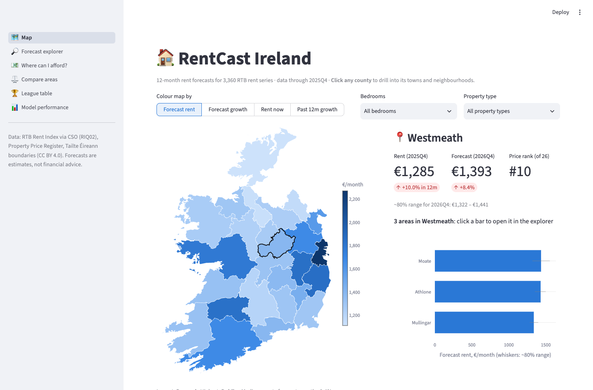
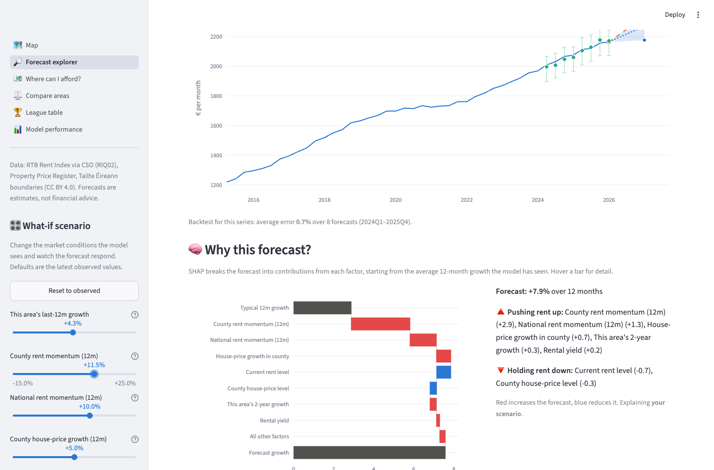
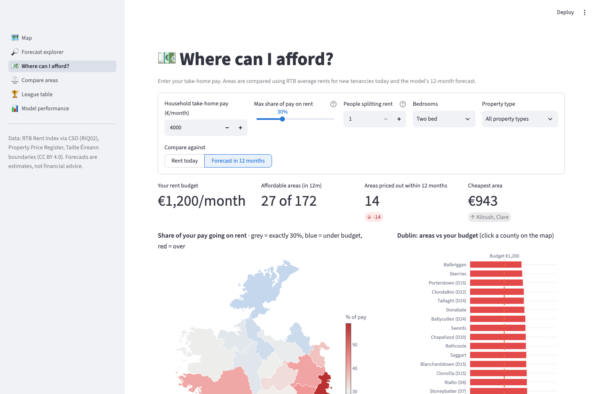
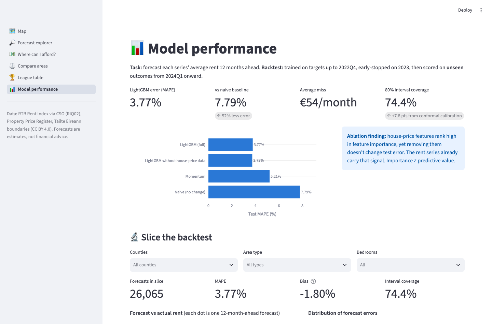
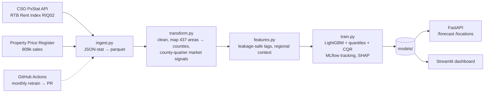

# RentCast Ireland 🏠

**12-month rent forecasts for every RTB-tracked area in Ireland**, with calibrated uncertainty ranges, an explainable "why", what-if scenarios and an affordability finder, served through a REST API and an interactive dashboard.

Ireland's rental crisis is one of the country's defining issues. Average rents have more than doubled since 2011. This project turns the official public data into forward-looking, area-level forecasts that a renter, a policy analyst or a housing body could actually use.



## Interactive dashboard

Six linked pages. A selection made on one page (a county clicked on the map, a row in a table) carries over to the others.

| Page | What you can do |
|---|---|
| 🗺️ **Map** | Click any county to drill into its towns and neighbourhoods; recolour by forecast rent, forecast growth or past growth; press ▶ to animate rents from 2008 to today |
| 🔎 **Forecast explorer** | History plus 12-month forecast and ~80% range; overlay the model's **past forecasts vs what actually happened**; **"Why this forecast?"** SHAP waterfall; **what-if sliders** (county or national momentum, house-price growth) that re-run the model live |
| 💶 **Where can I afford?** | Enter take-home pay, budget share and flatmates; see a diverging map of rent-to-income by county, the areas within budget, and which areas the forecast says will **price you out within 12 months** |
| ⚖️ **Compare areas** | Up to three areas side by side, in € or indexed to 100, with forecast ranges |
| 🏆 **League table** | Filter and rank all ~3,300 series, with sparklines, search and CSV export; click a row to open it |
| 📊 **Model performance** | Slice the backtest by county, area type or bedrooms: error, bias, interval coverage, forecast-vs-actual scatter |

| Explainable forecasts and what-if | Affordability finder |
|---|---|
|  |  |

## Results

Backtested on **26,065 unseen forecasts** (target quarters 2024Q1–2025Q4). The model was trained only on data available before each forecast was made.

| Model | MAPE | MAE (€/month) |
|---|---|---|
| Naive (rent stays flat) | 7.79% | €108.76 |
| Momentum (last year's growth repeats) | 5.21% | €75.93 |
| **LightGBM (this project)** | **3.77%** | **€53.95** |

- **52% lower error than the naive baseline, and 28% lower than momentum.**
- **Calibrated uncertainty:** intervals use conformalized quantile regression (CQR), which lifted 80%-interval coverage from 66.6% (raw quantiles) to **74.4%**.
- **Current forecast (2025Q4 → 2026Q4):** rents are converging. The cheapest counties are forecast to rise fastest (Leitrim and Donegal +11%), while Dublin rises least (+4.9%, from €2,165 to about €2,272).

### Findings worth discussing

1. **Feature importance ≠ predictive value.** Property Price Register features (house-price growth, sales volumes) rank #2 by LightGBM gain. Yet an ablation shows that removing them makes no difference out of sample (3.73% vs 3.77% MAPE). The rent series already carry that signal. That's why I validate features with ablations rather than trusting importance plots.
2. **Conformal guarantees assume exchangeability.** Coverage is still below the 80% target because the 2024–25 market behaved differently from the 2023 calibration year. Rolling or adaptive conformal calibration is the obvious next step.
3. **Real-world data drift.** The RTB retired Dublin postal-district series after 2021Q4 in favour of neighbourhood-level areas (e.g. "Rathmines, Dublin 6"), and it suppresses thin quarters. The pipeline handles both: it validates every location against a county mapping and serves each series from its most recent observation within the last year.



## Architecture



**Modelling approach**
- **Unit of prediction:** one rent series (area × bedrooms × property type) at one origin quarter, 7,490 series in total.
- **Target:** the 12-month-ahead log change in rent. Predicting growth rather than level lets one model work across €700 and €3,000 markets.
- **Features:** the series' own momentum and volatility; county and national rent growth; the area's premium over its county; Property Price Register median prices, sales volumes, new-build share and gross yield.
- **Validation:** time-based split on the *target* quarter. Training uses targets up to 2022, early stopping uses 2023, and the test set is 2024 onward. No random splits on time-series data.

## Tech stack

| Area | Tools |
|---|---|
| Data & ML | Python 3.12, pandas, scikit-learn, LightGBM, SHAP |
| MLOps | MLflow (SQLite backend), scheduled retraining via GitHub Actions |
| Serving | FastAPI + Pydantic (OpenAPI docs), Streamlit multipage app + Plotly (choropleths, click events, animation) |
| Engineering | uv, pytest, ruff, pre-commit, Docker, Docker Compose, GitHub Actions CI |

## Quickstart

Requires [uv](https://docs.astral.sh/uv/).

```bash
make install     # dependencies + pre-commit hooks
make pipeline    # download data, clean, train (~1 min)
make dashboard   # http://localhost:8501
make api         # http://localhost:8000/docs
make mlflow      # experiment runs at http://localhost:5000
make test
```

Or with Docker: `make up` (API on :8000, dashboard on :8501).

A trained model and processed data are committed, so `make api` and `make dashboard` work straight after `make install`.

### API example

```bash
curl -X POST localhost:8000/forecast -H 'content-type: application/json' \
  -d '{"location": "Rathmines, Dublin 6", "beds": "Two bed", "property_type": "Apartment"}'
```
```json
{
  "location": "Rathmines, Dublin 6", "county": "Dublin",
  "current_quarter": "2025Q4", "current_rent": 1983.9,
  "forecast_quarter": "2026Q4", "forecast_rent": 2094.56,
  "lower_rent": 1972.59, "upper_rent": 2232.22, "growth_pct": 5.58
}
```


## Project structure

```
src/rentcast/
  config.py            settings (env-overridable, RENTCAST_*)
  data/ingest.py       CSO PxStat + PPR download
  data/transform.py    cleaning, area→county mapping, market aggregates
  features.py          leakage-safe feature engineering
  train.py             baselines, LightGBM, CQR intervals, ablation, MLflow
  predict.py           Forecaster used by both API and dashboard
  api/main.py          FastAPI service
dashboard/app.py       Streamlit multipage entry point
dashboard/views/       map, explorer, affordability, compare, league table, model pages
dashboard/assets/      simplified county boundaries (scripts/build_counties_geojson.py)
tests/                 unit tests (parsing, mapping, leakage) + API tests
.github/workflows/     CI (lint, test, Docker smoke test) and monthly retrain
```

## Data sources

- **RTB Rent Index:** average monthly rent of new tenancies, quarterly 2007Q4–2025Q4. Published by the Residential Tenancies Board via the [CSO PxStat API](https://data.cso.ie/table/RIQ02), CC BY 4.0.
- **County boundaries:** [Tailte Éireann, National Statutory Boundaries 2019](https://data.gov.ie/dataset/counties-national-statutory-boundaries-2019-generalised-20m1), CC BY 4.0, reprojected and simplified to 61 KB.
- **Residential Property Price Register:** every residential sale in Ireland since 2010, from the [Property Services Regulatory Authority](https://www.propertypriceregister.ie). Only full-market-price sales are used.

## Limitations & next steps

- RTB figures cover *new* tenancies only, not rents paid by sitting tenants under Rent Pressure Zone caps.
- Add policy signals: Rent Pressure Zone status, and CSO population and housing-completion data.
- Use rolling or adaptive conformal calibration to fix the interval under-coverage.
- Try a global deep-learning forecaster (e.g. N-BEATS or TFT) as a challenger model.
- Deploy to Azure Container Apps or AWS App Runner behind the existing Docker image.
